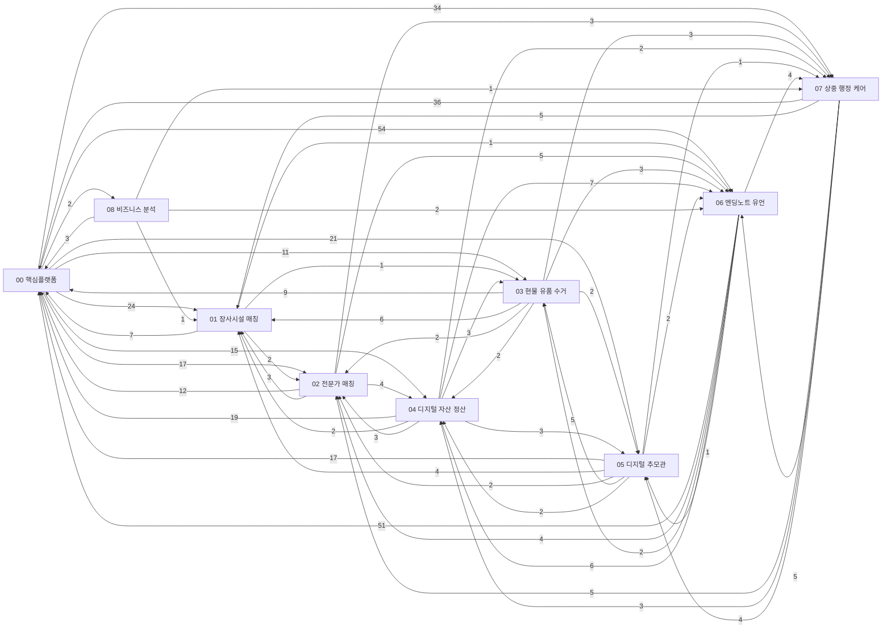

# 📚 [AI 에이전트 기획 SSOT 센터] 도메인별 마스터 문서 목차 & 포털

> **문서 목적**: 이어봄(Eobom) 프로젝트의 전체 기획, 기술 아키텍처, DB 명세, API 규격, 화면 설계, 경쟁사 분석 및 기술 솔루션을 **도메인 기반 마크다운(.md) 단일 진실 공급원(SSOT)**으로 아카이빙합니다.
> **마크다운 기획 문서 위치**: `docs/` (도메인별 한글 디렉토리)
> **사용자 열람용 HTML 및 시각화 보고서**: `reports/` (도메인별 한글 디렉토리 시각화 포털)
> 🔴 **2026-08-20 — `reports/`는 git 커밋에서 제외됐습니다**(로컬 전용). `docs/`에서 재생성되는
> 파생물이기 때문이며, 표의 "대응 HTML 보고서" 열은 **로컬 경로**를 가리킵니다.
> ⚠️ **`reports/`에만 있는 문서를 만들지 마십시오 — 커밋에서 빠져 소실됩니다**(→ `roles.md` §1-1).
> `00-24`가 그 상태였고 이번에 정본화했습니다.

<!-- AUTO-GENERATED:BEGIN docs-catalog:index-pending (docs-catalog.js — 직접 수정 금지, 문서 frontmatter를 고치고 index를 재실행) -->
**결정대기 문서 3개**

- `00-14` 사장님 논의 안건 정리
- `02-02` 전문가 계정 체계 구현 메모 (사장님 보고용 참고자료)
- `03-03` 유품수거 업체 데이터 확보 방안 결정서
<!-- AUTO-GENERATED:END -->

---

## 🧭 도메인 번호 체계 (**2026-08-12 재편 — 개발자 확정**)

**번호 = 사용자 여정 순서**입니다. **메뉴 순서와의 1:1 대응은 포기했습니다**(→ `00-12` §7).
메뉴가 생전 준비 / 임종 및 사후 정리 두 갈래로 나뉘어 "번호 = 메뉴 순서"가 성립하지 않기 때문입니다(메뉴 정본 = `modeNav.ts` · 좌측 사이드바는 폐지 — `00-39` §6-3).

| # | 도메인 | 화면(`tab id`) | 성격 | **WellDying** (생전 준비) | **유가족** (사후) |
| :---: | :--- | :--- | :--- | :---: | :---: |
| **01** | 장사시설 매칭 | `facility` | 거래(매칭) | | ⭕ |
| **02** | 전문가 매칭 (상속·법률) | `counseling` | 거래(매칭) | ⭕ | ⭕ |
| **03** | 현물 유품 수거 | `pickup` 🔄 | 거래(매칭) | | ⭕ |
| **04** | 디지털 자산 · 계정 정산 | `digital-estate` | 안내 | ❌ (생전 메뉴 제외 — 08-19) | ⭕ |
| **05** | 디지털 추모관 | `memorial`(내 추모관 관리) · `/m/:slug`(SCR-011 공개 화면) | 추모 | | ⭕ |
| **06** | 디지털 엔딩노트 · 유언 | `ending-note` | 생전 준비 | ⭕ | |
| **07** | 상중 · 행정 케어 | `care-guide` · `obituary` 🔄 | 동반 가이드 | | ⭕ |

> **화면 ID 정본 = `00-06` §1**(미할당 번호도 거기 — 10-12 기준 `SCR-022`부터). 04는 생전 준비 메뉴에서 빠졌고(08-19, IA 정의는 유지),
> 08-27에 만든 모드 진입 화면 `/prep`(SCR-016)·`/bereaved`(SCR-017)는 09-28 **폐지** — 지금은 홈 섹션2로 돌려보냅니다(`00-40` C6).
> 화면 ID 부여 경위는 `00-06` 끝 기록 줄.

**방문자는 두 방향으로 갈라집니다**(2026-08-12 개발자 정의):

- **WellDying 유저**(미래를 준비하는 본인) → **02 · 04 · 06**
- **유가족 유저** → **01 · 02 · 03 · 04 · 05 · 07**

**02·04만 양쪽에 걸칩니다. 다만 "양쪽"의 뜻이 서로 다릅니다** —
**02는 같은 기능을 두 주체가 각자 쓰는 것**(승계 없음)이고,
**04는 한 주체가 시작해 다른 주체가 끝내는 것**(승계 있음)입니다.

> ✅ **승계 원칙(2026-08-12 확정)**: 고인이 유족에게 **무언가를 남기는 통로는 06 하나**입니다.
> 다른 도메인이 각자 승계 경로를 만들지 않습니다 — 경로가 하나여야 `00-12` §4의 L4 게이트도
> 하나로 족합니다. **04는 예외인데, "전달"이 아니라 "위임"**이라 수신자가 유족이 아닐 수도 있어
> 06을 경유할 수 없기 때문입니다(→ `04-01` §9.1).
> **02는 승계 대상이 아닙니다** — 상담 이력은 유산이 아니고, 넘기면 유족 간 분쟁 소지 + 전문가
> 비밀 문제가 생깁니다. 고인이 담당 전문가를 알리고 싶으면 **06에 적어서 보냅니다.**

`00_핵심플랫폼`·`08_비즈니스_분석`은 특정 도메인에 속하지 않는 공통 영역입니다.
**08은 화면·기능이 없는 분석 문서 자리입니다**(`08-01` 하나).

**문서 번호 규칙**: `<도메인번호>-<순번>` (예: `01-05`). 도메인 안에서 01부터 시작하되 전역에서 유일하게 특정됩니다.
코드 주석에서 `docs 01-05 §3.4`처럼 축약 참조할 수 있어야 하므로 이 형식을 지킵니다.

---

## 🔗 도메인 관계 그래프

<!-- AUTO-GENERATED:BEGIN docs-catalog:index-graph (docs-catalog.js — 직접 수정 금지, 문서 frontmatter를 고치고 index를 재실행) -->

화살표 = 앞 도메인 문서가 뒤 도메인 문서를 인용(문서 쌍 수 · 부록 제외)
<!-- AUTO-GENERATED:END -->

---

## 📁 도메인별 기획 마크다운 문서 인덱스 (Domain-Driven Architecture)

### 🌿 00. 공통 플랫폼 & 코어 기반 (`00_핵심플랫폼/`)
> 전체 요약·HTML 보고서 경로 → [`00_DOCS_INDEX_상세.md`](00_DOCS_INDEX_상세.md) 의 같은 문서 ID 절

<!-- AUTO-GENERATED:BEGIN docs-catalog:index-D00 (docs-catalog.js — 직접 수정 금지, 문서 frontmatter를 고치고 index를 재실행) -->
| ID | 문서 | 제목 | 종류 | 상태 | topics | 참조됨 |
|---|---|---|---|---|---|---:|
| `00-01` | [00-01_신규_6대_기획_아이디어_및_로드맵.md](00_%ED%95%B5%EC%8B%AC%ED%94%8C%EB%9E%AB%ED%8F%BC/00-01_%EC%8B%A0%EA%B7%9C_6%EB%8C%80_%EA%B8%B0%ED%9A%8D_%EC%95%84%EC%9D%B4%EB%94%94%EC%96%B4_%EB%B0%8F_%EB%A1%9C%EB%93%9C%EB%A7%B5.md) | 01. 신규 6대 기획 아이디어 및 로드맵 | 기획서 | 경위기록 |  | 0 |
| `00-02` | [00-02_이어봄_서비스_개요_및_기획서.md](00_%ED%95%B5%EC%8B%AC%ED%94%8C%EB%9E%AB%ED%8F%BC/00-02_%EC%9D%B4%EC%96%B4%EB%B4%84_%EC%84%9C%EB%B9%84%EC%8A%A4_%EA%B0%9C%EC%9A%94_%EB%B0%8F_%EA%B8%B0%ED%9A%8D%EC%84%9C.md) | 02. 이어봄 서비스 개요 및 종합 기획서 | 기획서 | 확정 | 사망·고인, 파트너, 전문가 | 7 |
| `00-03` | [00-03_시스템_아키텍처_및_흐름도.md](00_%ED%95%B5%EC%8B%AC%ED%94%8C%EB%9E%AB%ED%8F%BC/00-03_%EC%8B%9C%EC%8A%A4%ED%85%9C_%EC%95%84%ED%82%A4%ED%85%8D%EC%B2%98_%EB%B0%8F_%ED%9D%90%EB%A6%84%EB%8F%84.md) | 시스템 아키텍처 및 흐름도 명세서 | 명세서 | 확정 | 인프라·배포, 암호화·보안, 외부연동 | 2 |
| `00-04` | [00-04_기능_및_API_명세서.md](00_%ED%95%B5%EC%8B%AC%ED%94%8C%EB%9E%AB%ED%8F%BC/00-04_%EA%B8%B0%EB%8A%A5_%EB%B0%8F_API_%EB%AA%85%EC%84%B8%EC%84%9C.md) | 기능 및 REST API 명세서 (전체 지도) | 명세서 | 확정 | API, 회원·인증, 운영자 | 6 |
| `00-05` | [00-05_DB_요구사항_및_테이블_사전.md](00_%ED%95%B5%EC%8B%AC%ED%94%8C%EB%9E%AB%ED%8F%BC/00-05_DB_%EC%9A%94%EA%B5%AC%EC%82%AC%ED%95%AD_%EB%B0%8F_%ED%85%8C%EC%9D%B4%EB%B8%94_%EC%82%AC%EC%A0%84.md) | DB 요구사항 및 테이블 사전 (Prisma Schema) | 명세서 | 확정 | DB | 11 |
| `00-06` | [00-06_화면_설계서_및_와이어프레임.md](00_%ED%95%B5%EC%8B%AC%ED%94%8C%EB%9E%AB%ED%8F%BC/00-06_%ED%99%94%EB%A9%B4_%EC%84%A4%EA%B3%84%EC%84%9C_%EB%B0%8F_%EC%99%80%EC%9D%B4%EC%96%B4%ED%94%84%EB%A0%88%EC%9E%84.md) | 화면 설계서 및 화면 인벤토리 | 명세서 | 확정 | 디자인, 회원·인증 | 21 |
| `00-07` | [00-07_구현_난관_및_기술_솔루션.md](00_%ED%95%B5%EC%8B%AC%ED%94%8C%EB%9E%AB%ED%8F%BC/00-07_%EA%B5%AC%ED%98%84_%EB%82%9C%EA%B4%80_%EB%B0%8F_%EA%B8%B0%EC%88%A0_%EC%86%94%EB%A3%A8%EC%85%98.md) | 08. 구현 난관 및 기술 솔루션 (Technical Solutions) | 메모 | 확정 | 외부연동, 공공데이터, 회원·인증 | 0 |
| `00-08` | [00-08_소셜로그인_및_계정통합_명세서.md](00_%ED%95%B5%EC%8B%AC%ED%94%8C%EB%9E%AB%ED%8F%BC/00-08_%EC%86%8C%EC%85%9C%EB%A1%9C%EA%B7%B8%EC%9D%B8_%EB%B0%8F_%EA%B3%84%EC%A0%95%ED%86%B5%ED%95%A9_%EB%AA%85%EC%84%B8%EC%84%9C.md) | 09. 소셜 로그인 및 계정 통합 명세서 | 명세서 | 확정 | 회원·인증, 외부연동 | 10 |
| `00-09` | [00-09_디자인_시스템_및_스타일_가이드.md](00_%ED%95%B5%EC%8B%AC%ED%94%8C%EB%9E%AB%ED%8F%BC/00-09_%EB%94%94%EC%9E%90%EC%9D%B8_%EC%8B%9C%EC%8A%A4%ED%85%9C_%EB%B0%8F_%EC%8A%A4%ED%83%80%EC%9D%BC_%EA%B0%80%EC%9D%B4%EB%93%9C.md) | 11. 디자인 시스템 및 스타일 가이드 (Design System & Style Guide) | 명세서 | 폐기 | 디자인 | 11 |
| `00-10` | [00-10_URL_라우팅_HistoryRouter_전환_구현_메모.md](00_%ED%95%B5%EC%8B%AC%ED%94%8C%EB%9E%AB%ED%8F%BC/00-10_URL_%EB%9D%BC%EC%9A%B0%ED%8C%85_HistoryRouter_%EC%A0%84%ED%99%98_%EA%B5%AC%ED%98%84_%EB%A9%94%EB%AA%A8.md) | 18. URL 라우팅 — 해시 방식 → HistoryRouter(BrowserRouter) 전환 구현 메모 | 메모 | 경위기록 | 인프라·배포 | 2 |
| `00-11` | [00-11_백엔드_DB_배포_및_인프라_전략_결정서.md](00_%ED%95%B5%EC%8B%AC%ED%94%8C%EB%9E%AB%ED%8F%BC/00-11_%EB%B0%B1%EC%97%94%EB%93%9C_DB_%EB%B0%B0%ED%8F%AC_%EB%B0%8F_%EC%9D%B8%ED%94%84%EB%9D%BC_%EC%A0%84%EB%9E%B5_%EA%B2%B0%EC%A0%95%EC%84%9C.md) | 백엔드 · DB 배포 및 인프라 전략 결정서 | 결정서 | 부분확정 | 인프라·배포, DB, 개인정보 | 20 |
| `00-12` | [00-12_사망_이벤트_고인계정_유족연동_공통기반_기획서.md](00_%ED%95%B5%EC%8B%AC%ED%94%8C%EB%9E%AB%ED%8F%BC/00-12_%EC%82%AC%EB%A7%9D_%EC%9D%B4%EB%B2%A4%ED%8A%B8_%EA%B3%A0%EC%9D%B8%EA%B3%84%EC%A0%95_%EC%9C%A0%EC%A1%B1%EC%97%B0%EB%8F%99_%EA%B3%B5%ED%86%B5%EA%B8%B0%EB%B0%98_%EA%B8%B0%ED%9A%8D%EC%84%9C.md) | 사망 이벤트 · 고인 계정 · 유족 연동 — 공통 기반 기획서 | 기획서 | 확정 | 사망·고인, 가족연결, 회원·인증 | 32 |
| `00-13` | [00-13_추모관_공유링크_모델_결정서.md](00_%ED%95%B5%EC%8B%AC%ED%94%8C%EB%9E%AB%ED%8F%BC/00-13_%EC%B6%94%EB%AA%A8%EA%B4%80_%EA%B3%B5%EC%9C%A0%EB%A7%81%ED%81%AC_%EB%AA%A8%EB%8D%B8_%EA%B2%B0%EC%A0%95%EC%84%9C.md) | 추모관 공유 링크 모델 — 결정서 | 결정서 | 확정 | 사망·고인, 개인정보 | 14 |
| `00-14` | [00-14_사장님_논의_안건_정리.md](00_%ED%95%B5%EC%8B%AC%ED%94%8C%EB%9E%AB%ED%8F%BC/00-14_%EC%82%AC%EC%9E%A5%EB%8B%98_%EB%85%BC%EC%9D%98_%EC%95%88%EA%B1%B4_%EC%A0%95%EB%A6%AC.md) | 사장님 논의 안건 정리 | 메모 | 결정대기 | 법률쟁점, 수익·정산 | 25 |
| `00-15` | [00-15_회귀_테스트_도입_검토서.md](00_%ED%95%B5%EC%8B%AC%ED%94%8C%EB%9E%AB%ED%8F%BC/00-15_%ED%9A%8C%EA%B7%80_%ED%85%8C%EC%8A%A4%ED%8A%B8_%EB%8F%84%EC%9E%85_%EA%B2%80%ED%86%A0%EC%84%9C.md) | 회귀 테스트 체계 도입 — 검토서 | 검토서 | 확정 |  | 6 |
| `00-16` | [00-16_L3_사망확인_서류_검토서.md](00_%ED%95%B5%EC%8B%AC%ED%94%8C%EB%9E%AB%ED%8F%BC/00-16_L3_%EC%82%AC%EB%A7%9D%ED%99%95%EC%9D%B8_%EC%84%9C%EB%A5%98_%EA%B2%80%ED%86%A0%EC%84%9C.md) | L3 사망확인 서류 — 검토서 | 검토서 | 확정 | 사망·고인, 개인정보, 법률쟁점 | 17 |
| `00-17` | [00-17_개인정보_인증_및_국외이전_대응안.md](00_%ED%95%B5%EC%8B%AC%ED%94%8C%EB%9E%AB%ED%8F%BC/00-17_%EA%B0%9C%EC%9D%B8%EC%A0%95%EB%B3%B4_%EC%9D%B8%EC%A6%9D_%EB%B0%8F_%EA%B5%AD%EC%99%B8%EC%9D%B4%EC%A0%84_%EB%8C%80%EC%9D%91%EC%95%88.md) | 개인정보 인증(ISMS-P) 대상 여부 · 국외이전 — 대응안 | 검토서 | 확정 | 개인정보, 법률쟁점, 암호화·보안 | 8 |
| `00-18` | [00-18_개인정보처리방침_및_이용약관_기획서.md](00_%ED%95%B5%EC%8B%AC%ED%94%8C%EB%9E%AB%ED%8F%BC/00-18_%EA%B0%9C%EC%9D%B8%EC%A0%95%EB%B3%B4%EC%B2%98%EB%A6%AC%EB%B0%A9%EC%B9%A8_%EB%B0%8F_%EC%9D%B4%EC%9A%A9%EC%95%BD%EA%B4%80_%EA%B8%B0%ED%9A%8D%EC%84%9C.md) | 개인정보처리방침 · 이용약관 — 초안 설계서 | 기획서 | 확정 | 약관·처리방침, 개인정보, 파기·보존 | 13 |
| `00-19` | [00-19_개인정보처리방침_초안.md](00_%ED%95%B5%EC%8B%AC%ED%94%8C%EB%9E%AB%ED%8F%BC/00-19_%EA%B0%9C%EC%9D%B8%EC%A0%95%EB%B3%B4%EC%B2%98%EB%A6%AC%EB%B0%A9%EC%B9%A8_%EC%B4%88%EC%95%88.md) | 개인정보처리방침 — **v0.9 초안** | 초안본문 | 확정 | 약관·처리방침, 개인정보, 파기·보존 | 25 |
| `00-20` | [00-20_추모관_보존기간_및_폐쇄정책_검토서.md](00_%ED%95%B5%EC%8B%AC%ED%94%8C%EB%9E%AB%ED%8F%BC/00-20_%EC%B6%94%EB%AA%A8%EA%B4%80_%EB%B3%B4%EC%A1%B4%EA%B8%B0%EA%B0%84_%EB%B0%8F_%ED%8F%90%EC%87%84%EC%A0%95%EC%B1%85_%EA%B2%80%ED%86%A0%EC%84%9C.md) | 추모관 보존기간 · 폐쇄 정책 — 검토서 | 검토서 | 확정 | 파기·보존, 사망·고인 | 19 |
| `00-21` | [00-21_서비스_이용약관_초안.md](00_%ED%95%B5%EC%8B%AC%ED%94%8C%EB%9E%AB%ED%8F%BC/00-21_%EC%84%9C%EB%B9%84%EC%8A%A4_%EC%9D%B4%EC%9A%A9%EC%95%BD%EA%B4%80_%EC%B4%88%EC%95%88.md) | 서비스 이용약관 — **v0.9 초안** | 초안본문 | 확정 | 약관·처리방침, 위치정보 | 14 |
| `00-22` | [00-22_법적_요구사항_체크리스트.md](00_%ED%95%B5%EC%8B%AC%ED%94%8C%EB%9E%AB%ED%8F%BC/00-22_%EB%B2%95%EC%A0%81_%EC%9A%94%EA%B5%AC%EC%82%AC%ED%95%AD_%EC%B2%B4%ED%81%AC%EB%A6%AC%EC%8A%A4%ED%8A%B8.md) | 법적 요구사항 — 체크리스트 | 추적 | 확정 | 법률쟁점, 개인정보, 위치정보 | 17 |
| `00-23` | [00-23_메인화면_진입구조_개편_검토서.md](00_%ED%95%B5%EC%8B%AC%ED%94%8C%EB%9E%AB%ED%8F%BC/00-23_%EB%A9%94%EC%9D%B8%ED%99%94%EB%A9%B4_%EC%A7%84%EC%9E%85%EA%B5%AC%EC%A1%B0_%EA%B0%9C%ED%8E%B8_%EA%B2%80%ED%86%A0%EC%84%9C.md) | 메인화면 진입구조 개편 — 검토서 | 검토서 | 확정 | 디자인 | 11 |
| `00-24` | [00-24_프론트엔드_UIUX_개선_제안서.md](00_%ED%95%B5%EC%8B%AC%ED%94%8C%EB%9E%AB%ED%8F%BC/00-24_%ED%94%84%EB%A1%A0%ED%8A%B8%EC%97%94%EB%93%9C_UIUX_%EA%B0%9C%EC%84%A0_%EC%A0%9C%EC%95%88%EC%84%9C.md) | 프론트엔드 UI/UX 개선 제안서 | 기획서 | 확정 | 디자인 | 1 |
| `00-25` | [00-25_인터페이스_템플릿_기술분석_및_메인적용방안.md](00_%ED%95%B5%EC%8B%AC%ED%94%8C%EB%9E%AB%ED%8F%BC/00-25_%EC%9D%B8%ED%84%B0%ED%8E%98%EC%9D%B4%EC%8A%A4_%ED%85%9C%ED%94%8C%EB%A6%BF_%EA%B8%B0%EC%88%A0%EB%B6%84%EC%84%9D_%EB%B0%8F_%EB%A9%94%EC%9D%B8%EC%A0%81%EC%9A%A9%EB%B0%A9%EC%95%88.md) | 인터페이스(interface) 템플릿 기술 분석 및 메인 적용 방안 | 메모 | 폐기 | 디자인 | 0 |
| `00-26` | [00-26_모드별_네비게이션_개편_검토서.md](00_%ED%95%B5%EC%8B%AC%ED%94%8C%EB%9E%AB%ED%8F%BC/00-26_%EB%AA%A8%EB%93%9C%EB%B3%84_%EB%84%A4%EB%B9%84%EA%B2%8C%EC%9D%B4%EC%85%98_%EA%B0%9C%ED%8E%B8_%EA%B2%80%ED%86%A0%EC%84%9C.md) | 모드별 네비게이션 개편 — 검토서 | 검토서 | 확정 | 디자인, 회원·인증 | 19 |
| `00-27` | [00-27_생전_가족지정_및_유족연결_기획서.md](00_%ED%95%B5%EC%8B%AC%ED%94%8C%EB%9E%AB%ED%8F%BC/00-27_%EC%83%9D%EC%A0%84_%EA%B0%80%EC%A1%B1%EC%A7%80%EC%A0%95_%EB%B0%8F_%EC%9C%A0%EC%A1%B1%EC%97%B0%EA%B2%B0_%EA%B8%B0%ED%9A%8D%EC%84%9C.md) | 생전 가족지정 및 유족연결 기획서 | 기획서 | 확정 | 가족연결, 개인정보 | 19 |
| `00-28` | [00-28_회원_프로필_정보수집_기획서.md](00_%ED%95%B5%EC%8B%AC%ED%94%8C%EB%9E%AB%ED%8F%BC/00-28_%ED%9A%8C%EC%9B%90_%ED%94%84%EB%A1%9C%ED%95%84_%EC%A0%95%EB%B3%B4%EC%88%98%EC%A7%91_%EA%B8%B0%ED%9A%8D%EC%84%9C.md) | 회원 프로필 정보수집 기획서 | 기획서 | 확정 | 개인정보, 위치정보, 회원·인증 | 5 |
| `00-29` | [00-29_모바일_대응_전략_검토서.md](00_%ED%95%B5%EC%8B%AC%ED%94%8C%EB%9E%AB%ED%8F%BC/00-29_%EB%AA%A8%EB%B0%94%EC%9D%BC_%EB%8C%80%EC%9D%91_%EC%A0%84%EB%9E%B5_%EA%B2%80%ED%86%A0%EC%84%9C.md) | 모바일 대응 전략 — 검토서 | 검토서 | 확정 | 모바일, 디자인 | 4 |
| `00-30` | [00-30_생애주기_연결모델_검토서.md](00_%ED%95%B5%EC%8B%AC%ED%94%8C%EB%9E%AB%ED%8F%BC/00-30_%EC%83%9D%EC%95%A0%EC%A3%BC%EA%B8%B0_%EC%97%B0%EA%B2%B0%EB%AA%A8%EB%8D%B8_%EA%B2%80%ED%86%A0%EC%84%9C.md) | 3단계 생애주기 연결 모델 — 전 도메인 검토서 | 검토서 | 확정 | 가족연결, 사망·고인 | 5 |
| `00-31` | [00-31_랜딩페이지_카피_원고.md](00_%ED%95%B5%EC%8B%AC%ED%94%8C%EB%9E%AB%ED%8F%BC/00-31_%EB%9E%9C%EB%94%A9%ED%8E%98%EC%9D%B4%EC%A7%80_%EC%B9%B4%ED%94%BC_%EC%9B%90%EA%B3%A0.md) | 이어봄 랜딩페이지 카피 원고 | 초안본문 | 확정 | 디자인, 법률쟁점 | 3 |
| `00-32` | [00-32_이미지_생성_프롬프트_가이드.md](00_%ED%95%B5%EC%8B%AC%ED%94%8C%EB%9E%AB%ED%8F%BC/00-32_%EC%9D%B4%EB%AF%B8%EC%A7%80_%EC%83%9D%EC%84%B1_%ED%94%84%EB%A1%AC%ED%94%84%ED%8A%B8_%EA%B0%80%EC%9D%B4%EB%93%9C.md) | 이어봄 이미지 생성 프롬프트 가이드 | 명세서 | 확정 | 디자인 | 0 |
| `00-33` | [00-33_암호화_키_관리_및_교체_전략_명세서.md](00_%ED%95%B5%EC%8B%AC%ED%94%8C%EB%9E%AB%ED%8F%BC/00-33_%EC%95%94%ED%98%B8%ED%99%94_%ED%82%A4_%EA%B4%80%EB%A6%AC_%EB%B0%8F_%EA%B5%90%EC%B2%B4_%EC%A0%84%EB%9E%B5_%EB%AA%85%EC%84%B8%EC%84%9C.md) | 암호화 키 관리 및 교체(로테이션) 전략 — 명세서 | 명세서 | 확정 | 암호화·보안, DB | 12 |
| `00-34` | [00-34_프론트엔드_공통_레이어_명세서.md](00_%ED%95%B5%EC%8B%AC%ED%94%8C%EB%9E%AB%ED%8F%BC/00-34_%ED%94%84%EB%A1%A0%ED%8A%B8%EC%97%94%EB%93%9C_%EA%B3%B5%ED%86%B5_%EB%A0%88%EC%9D%B4%EC%96%B4_%EB%AA%85%EC%84%B8%EC%84%9C.md) | 프론트엔드 공통 레이어 명세서 | 명세서 | 확정 | API, 회원·인증 | 6 |
| `00-35` | [00-35_엔딩노트_페이지_구조_정리_명세서.md](00_%ED%95%B5%EC%8B%AC%ED%94%8C%EB%9E%AB%ED%8F%BC/00-35_%EC%97%94%EB%94%A9%EB%85%B8%ED%8A%B8_%ED%8E%98%EC%9D%B4%EC%A7%80_%EA%B5%AC%EC%A1%B0_%EC%A0%95%EB%A6%AC_%EB%AA%85%EC%84%B8%EC%84%9C.md) | 엔딩노트 페이지 구조 정리 명세서 | 명세서 | 확정 |  | 1 |
| `00-36` | [00-36_마이페이지_정보구조_점검_및_개편_기획서.md](00_%ED%95%B5%EC%8B%AC%ED%94%8C%EB%9E%AB%ED%8F%BC/00-36_%EB%A7%88%EC%9D%B4%ED%8E%98%EC%9D%B4%EC%A7%80_%EC%A0%95%EB%B3%B4%EA%B5%AC%EC%A1%B0_%EC%A0%90%EA%B2%80_%EB%B0%8F_%EA%B0%9C%ED%8E%B8_%EA%B8%B0%ED%9A%8D%EC%84%9C.md) | 마이페이지 정보구조 점검 및 개편 기획서 | 기획서 | 확정 | 회원·인증, 디자인 | 10 |
| `00-37` | [00-37_운영자_콘솔_확장_및_접근분리_기획서.md](00_%ED%95%B5%EC%8B%AC%ED%94%8C%EB%9E%AB%ED%8F%BC/00-37_%EC%9A%B4%EC%98%81%EC%9E%90_%EC%BD%98%EC%86%94_%ED%99%95%EC%9E%A5_%EB%B0%8F_%EC%A0%91%EA%B7%BC%EB%B6%84%EB%A6%AC_%EA%B8%B0%ED%9A%8D%EC%84%9C.md) | 운영자 콘솔 확장 및 접근 분리 기획서 | 기획서 | 확정 | 운영자, 암호화·보안 | 10 |
| `00-38` | [00-38_적응형_모바일_UX_개편_명세서.md](00_%ED%95%B5%EC%8B%AC%ED%94%8C%EB%9E%AB%ED%8F%BC/00-38_%EC%A0%81%EC%9D%91%ED%98%95_%EB%AA%A8%EB%B0%94%EC%9D%BC_UX_%EA%B0%9C%ED%8E%B8_%EB%AA%85%EC%84%B8%EC%84%9C.md) | 적응형 모바일 UX 개편 — 명세서 | 명세서 | 확정 | 모바일, 디자인 | 12 |
| `00-39` | [00-39_디자인_기준_재정립_명세서.md](00_%ED%95%B5%EC%8B%AC%ED%94%8C%EB%9E%AB%ED%8F%BC/00-39_%EB%94%94%EC%9E%90%EC%9D%B8_%EA%B8%B0%EC%A4%80_%EC%9E%AC%EC%A0%95%EB%A6%BD_%EB%AA%85%EC%84%B8%EC%84%9C.md) | 디자인 기준 재정립 — 명세서 | 명세서 | 확정 | 디자인 | 25 |
| `00-40` | [00-40_홈_랜딩_재설계_계획서.md](00_%ED%95%B5%EC%8B%AC%ED%94%8C%EB%9E%AB%ED%8F%BC/00-40_%ED%99%88_%EB%9E%9C%EB%94%A9_%EC%9E%AC%EC%84%A4%EA%B3%84_%EA%B3%84%ED%9A%8D%EC%84%9C.md) | 홈(랜딩) 재설계 계획서 — 그룹⑤ `home` | 기획서 | 확정 | 디자인 | 12 |
| `00-41` | [00-41_사후개봉_최소안_명세서.md](00_%ED%95%B5%EC%8B%AC%ED%94%8C%EB%9E%AB%ED%8F%BC/00-41_%EC%82%AC%ED%9B%84%EA%B0%9C%EB%B4%89_%EC%B5%9C%EC%86%8C%EC%95%88_%EB%AA%85%EC%84%B8%EC%84%9C.md) | 사후 개봉 최소안 — `06-04` Phase 3 착수 스펙 | 명세서 | 확정 | 사망·고인, 운영자 | 22 |
| `00-42` | [00-42_운영_기록_로그_설계서.md](00_%ED%95%B5%EC%8B%AC%ED%94%8C%EB%9E%AB%ED%8F%BC/00-42_%EC%9A%B4%EC%98%81_%EA%B8%B0%EB%A1%9D_%EB%A1%9C%EA%B7%B8_%EC%84%A4%EA%B3%84%EC%84%9C.md) | 운영 기록(로그) 설계서 — 무엇을 남기고, 무엇을 남기지 않는가 | 명세서 | 확정 | 개인정보, 법률쟁점, 파기·보존 | 8 |
| `00-43` | [00-43_접속기록_월간점검_담당자_안내서.md](00_%ED%95%B5%EC%8B%AC%ED%94%8C%EB%9E%AB%ED%8F%BC/00-43_%EC%A0%91%EC%86%8D%EA%B8%B0%EB%A1%9D_%EC%9B%94%EA%B0%84%EC%A0%90%EA%B2%80_%EB%8B%B4%EB%8B%B9%EC%9E%90_%EC%95%88%EB%82%B4%EC%84%9C.md) | 접속기록 월간 점검 — 담당자 안내서 | 메모 | 확정 | 개인정보, 운영자 | 3 |
<!-- AUTO-GENERATED:END -->

---

### 🪦 01. Domain 01: 장사시설 매칭 (`01_장사시설_매칭/`)
> 장례식장 · 봉안당 · 수목장 탐색/매칭. 화면 `facility`. **구현 최다 진행 도메인** (시설 약 2천 건 — 로컬 DB 2,024건, 10-08 조회 + 사업자회원·리드 정산 인프라).

> 전체 요약·HTML 보고서 경로 → [`00_DOCS_INDEX_상세.md`](00_DOCS_INDEX_상세.md) 의 같은 문서 ID 절

<!-- AUTO-GENERATED:BEGIN docs-catalog:index-D01 (docs-catalog.js — 직접 수정 금지, 문서 frontmatter를 고치고 index를 재실행) -->
| ID | 문서 | 제목 | 종류 | 상태 | topics | 참조됨 |
|---|---|---|---|---|---|---:|
| `01-01` | [01-01_장례_묘지_매칭_기능_명세서.md](01_%EC%9E%A5%EC%82%AC%EC%8B%9C%EC%84%A4_%EB%A7%A4%EC%B9%AD/01-01_%EC%9E%A5%EB%A1%80_%EB%AC%98%EC%A7%80_%EB%A7%A4%EC%B9%AD_%EA%B8%B0%EB%8A%A5_%EB%AA%85%EC%84%B8%EC%84%9C.md) | 장례 · 묘지 매칭 기능 및 데이터 연동 상세 명세서 | 명세서 | 부분확정 | 공공데이터, 위치정보, 파트너 | 13 |
| `01-02` | [01-02_공공데이터_및_API_상업적_이용_법률_검토서.md](01_%EC%9E%A5%EC%82%AC%EC%8B%9C%EC%84%A4_%EB%A7%A4%EC%B9%AD/01-02_%EA%B3%B5%EA%B3%B5%EB%8D%B0%EC%9D%B4%ED%84%B0_%EB%B0%8F_API_%EC%83%81%EC%97%85%EC%A0%81_%EC%9D%B4%EC%9A%A9_%EB%B2%95%EB%A5%A0_%EA%B2%80%ED%86%A0%EC%84%9C.md) | 공공데이터 및 지도 API 상업적 이용 & 위치정보법 2단계 법률 검토서 | 검토서 | 확정 | 공공데이터, 위치정보, 법률쟁점, 외부연동 | 9 |
| `01-03` | [01-03_장례_견적비교_데이터한계_극복_3대_기획안.md](01_%EC%9E%A5%EC%82%AC%EC%8B%9C%EC%84%A4_%EB%A7%A4%EC%B9%AD/01-03_%EC%9E%A5%EB%A1%80_%EA%B2%AC%EC%A0%81%EB%B9%84%EA%B5%90_%EB%8D%B0%EC%9D%B4%ED%84%B0%ED%95%9C%EA%B3%84_%EA%B7%B9%EB%B3%B5_3%EB%8C%80_%EA%B8%B0%ED%9A%8D%EC%95%88.md) | 장례 견적 비교 데이터 한계 극복 3대 기획 대안 검토서 (PM 의사결정용) | 메모 | 경위기록 | 수익·정산, 파트너 | 2 |
| `01-04` | [01-04_장례_답사예약_vs_직통전화_UX_및_수익모델_검토서.md](01_%EC%9E%A5%EC%82%AC%EC%8B%9C%EC%84%A4_%EB%A7%A4%EC%B9%AD/01-04_%EC%9E%A5%EB%A1%80_%EB%8B%B5%EC%82%AC%EC%98%88%EC%95%BD_vs_%EC%A7%81%ED%86%B5%EC%A0%84%ED%99%94_UX_%EB%B0%8F_%EC%88%98%EC%9D%B5%EB%AA%A8%EB%8D%B8_%EA%B2%80%ED%86%A0%EC%84%9C.md) | 장례 답사 예약 폼 vs 직통 전화 연결 UX & 수익 모델 검토서 (PM 의사결정용) | 검토서 | 경위기록 | 수익·정산, 파트너 | 4 |
| `01-05` | [01-05_장사시설_사업자회원_및_리드_수수료_정산_명세서.md](01_%EC%9E%A5%EC%82%AC%EC%8B%9C%EC%84%A4_%EB%A7%A4%EC%B9%AD/01-05_%EC%9E%A5%EC%82%AC%EC%8B%9C%EC%84%A4_%EC%82%AC%EC%97%85%EC%9E%90%ED%9A%8C%EC%9B%90_%EB%B0%8F_%EB%A6%AC%EB%93%9C_%EC%88%98%EC%88%98%EB%A3%8C_%EC%A0%95%EC%82%B0_%EB%AA%85%EC%84%B8%EC%84%9C.md) | 장사시설 사업자 회원 & 리드 수수료 정산 명세서 | 명세서 | 부분확정 | 파트너, 수익·정산, 개인정보 | 29 |
| `01-06` | [01-06_시설_태그_분류_체계_명세서.md](01_%EC%9E%A5%EC%82%AC%EC%8B%9C%EC%84%A4_%EB%A7%A4%EC%B9%AD/01-06_%EC%8B%9C%EC%84%A4_%ED%83%9C%EA%B7%B8_%EB%B6%84%EB%A5%98_%EC%B2%B4%EA%B3%84_%EB%AA%85%EC%84%B8%EC%84%9C.md) | 시설 태그(#해시태그) 분류 체계 명세서 | 명세서 | 확정 |  | 1 |
<!-- AUTO-GENERATED:END -->

---

### ⚖️ 02. Domain 02: 전문가 매칭 — 상속 · 법률 케어 (`02_전문가_매칭/`)
> 변호사 · 세무사 · 행정사 · 장례지도사 매칭. 화면 `counseling`. `Expert` 계정 체계는 구축됨, 상담 신청은 Stage 1 구현.
> 🟡 **생전·유족 양쪽 도메인**(`00-12` §7.1) — 다만 "양쪽"의 뜻이 04와 다릅니다. **02는 같은 기능을 두 주체가 각자 쓰는 것이고 승계는 없습니다.**

> 전체 요약·HTML 보고서 경로 → [`00_DOCS_INDEX_상세.md`](00_DOCS_INDEX_상세.md) 의 같은 문서 ID 절

<!-- AUTO-GENERATED:BEGIN docs-catalog:index-D02 (docs-catalog.js — 직접 수정 금지, 문서 frontmatter를 고치고 index를 재실행) -->
| ID | 문서 | 제목 | 종류 | 상태 | topics | 참조됨 |
|---|---|---|---|---|---|---:|
| `02-01` | [02-01_전문가상담_도메인_상업화_및_구체화_명세서.md](02_%EC%A0%84%EB%AC%B8%EA%B0%80_%EB%A7%A4%EC%B9%AD/02-01_%EC%A0%84%EB%AC%B8%EA%B0%80%EC%83%81%EB%8B%B4_%EB%8F%84%EB%A9%94%EC%9D%B8_%EC%83%81%EC%97%85%ED%99%94_%EB%B0%8F_%EA%B5%AC%EC%B2%B4%ED%99%94_%EB%AA%85%EC%84%B8%EC%84%9C.md) | 전문가 상담 도메인 상업화 및 직역별 컴플라이언스 명세서 (Counseling Master) | 명세서 | 확정 | 전문가, 법률쟁점, 수익·정산 | 10 |
| `02-02` | [02-02_전문가_계정_체계_구현_메모.md](02_%EC%A0%84%EB%AC%B8%EA%B0%80_%EB%A7%A4%EC%B9%AD/02-02_%EC%A0%84%EB%AC%B8%EA%B0%80_%EA%B3%84%EC%A0%95_%EC%B2%B4%EA%B3%84_%EA%B5%AC%ED%98%84_%EB%A9%94%EB%AA%A8.md) | 전문가 계정 체계 구현 메모 (사장님 보고용 참고자료) | 메모 | 결정대기 | 전문가, 회원·인증, 법률쟁점 | 7 |
| `02-03` | [02-03_전문가_공개노출_및_상담신청_명세서.md](02_%EC%A0%84%EB%AC%B8%EA%B0%80_%EB%A7%A4%EC%B9%AD/02-03_%EC%A0%84%EB%AC%B8%EA%B0%80_%EA%B3%B5%EA%B0%9C%EB%85%B8%EC%B6%9C_%EB%B0%8F_%EC%83%81%EB%8B%B4%EC%8B%A0%EC%B2%AD_%EB%AA%85%EC%84%B8%EC%84%9C.md) | 전문가 매칭 — 공개 노출 및 상담 신청 명세서 | 명세서 | 확정 | 전문가, 법률쟁점, 개인정보 | 16 |
| `02-04` | [02-04_전문가_매칭_생전_WellDying_축_기획서.md](02_%EC%A0%84%EB%AC%B8%EA%B0%80_%EB%A7%A4%EC%B9%AD/02-04_%EC%A0%84%EB%AC%B8%EA%B0%80_%EB%A7%A4%EC%B9%AD_%EC%83%9D%EC%A0%84_WellDying_%EC%B6%95_%EA%B8%B0%ED%9A%8D%EC%84%9C.md) | 전문가 매칭 — 생전(WellDying) 축 기획서 | 기획서 | 확정 | 전문가, 법률쟁점, 수익·정산 | 7 |
| `02-05` | [02-05_전문가_직역_확장_및_상황기반_진입_기획서.md](02_%EC%A0%84%EB%AC%B8%EA%B0%80_%EB%A7%A4%EC%B9%AD/02-05_%EC%A0%84%EB%AC%B8%EA%B0%80_%EC%A7%81%EC%97%AD_%ED%99%95%EC%9E%A5_%EB%B0%8F_%EC%83%81%ED%99%A9%EA%B8%B0%EB%B0%98_%EC%A7%84%EC%9E%85_%EA%B8%B0%ED%9A%8D%EC%84%9C.md) | 전문가 직역 확장 및 상황 기반 진입 — 기획서 | 기획서 | 확정 | 전문가, 법률쟁점, 수익·정산 | 11 |
<!-- AUTO-GENERATED:END -->

---

### 📦 03. Domain 03: 현물 유품 수거 (`03_현물_유품_수거/`)
> 유품 정리·수거 업체 매칭. **유가족 전용.**
> ✅ **2026-08-14 기획 보류 해제** — 계정 형태가 **`Partner` 확장 + 별도 도메인 운영**으로 확정
> (`00-14` §4-2 개발자 확정). 상위 기획서는 `03-02`이며 `03-01`은 경위 기록이 됐습니다.

> 전체 요약·HTML 보고서 경로 → [`00_DOCS_INDEX_상세.md`](00_DOCS_INDEX_상세.md) 의 같은 문서 ID 절

<!-- AUTO-GENERATED:BEGIN docs-catalog:index-D03 (docs-catalog.js — 직접 수정 금지, 문서 frontmatter를 고치고 index를 재실행) -->
| ID | 문서 | 제목 | 종류 | 상태 | topics | 참조됨 |
|---|---|---|---|---|---|---:|
| `03-01` | [03-01_현물_유품_수거_계정형태_보류_메모.md](03_%ED%98%84%EB%AC%BC_%EC%9C%A0%ED%92%88_%EC%88%98%EA%B1%B0/03-01_%ED%98%84%EB%AC%BC_%EC%9C%A0%ED%92%88_%EC%88%98%EA%B1%B0_%EA%B3%84%EC%A0%95%ED%98%95%ED%83%9C_%EB%B3%B4%EB%A5%98_%EB%A9%94%EB%AA%A8.md) | 현물 유품 수거 — 계정 형태 보류 메모 (+ 회원 연동 설계 원칙) | 메모 | 경위기록 | 파트너, 회원·인증 | 5 |
| `03-02` | [03-02_현물_유품_수거_도메인_기획서.md](03_%ED%98%84%EB%AC%BC_%EC%9C%A0%ED%92%88_%EC%88%98%EA%B1%B0/03-02_%ED%98%84%EB%AC%BC_%EC%9C%A0%ED%92%88_%EC%88%98%EA%B1%B0_%EB%8F%84%EB%A9%94%EC%9D%B8_%EA%B8%B0%ED%9A%8D%EC%84%9C.md) | 현물 유품 수거 — 도메인 상위 기획서 | 기획서 | 확정 | 파트너, 수익·정산, 법률쟁점 | 15 |
| `03-03` | [03-03_유품수거_업체_데이터_확보_방안_결정서.md](03_%ED%98%84%EB%AC%BC_%EC%9C%A0%ED%92%88_%EC%88%98%EA%B1%B0/03-03_%EC%9C%A0%ED%92%88%EC%88%98%EA%B1%B0_%EC%97%85%EC%B2%B4_%EB%8D%B0%EC%9D%B4%ED%84%B0_%ED%99%95%EB%B3%B4_%EB%B0%A9%EC%95%88_%EA%B2%B0%EC%A0%95%EC%84%9C.md) | 유품수거 업체 데이터 확보 방안 결정서 | 결정서 | 결정대기 | 공공데이터, 외부연동, 파트너 | 6 |
<!-- AUTO-GENERATED:END -->

---

### 🔐 04. Domain 04: 디지털 자산 · 계정 정산 (`04_디지털_자산_정산/`)
> 고인 디지털 계정 **삭제·해지·추모 전환 안내**. 화면 `digital-estate`(SCR-003) — 화면 이름 **「디지털 정산」**(09-21 사람 지시 · 08-31 「디지털 계정 정리」에서 바뀜).
> ✅ **2026-09-30 — 안내 화면으로 축소**: 04 백엔드 삭제(`DigitalPlatform`·`DigitalCleanupItem`·`PreDeathDirective` 모델 없음) · 생전 계획 접음 · 진행 추적 없음. 화면은 **안내 + 안심상속 원스톱**만(`DigitalEstatePage`).
> 제품 정의는 **`04-01` §0**, 근거 조사는 **`04-03`**. 🔴 **고인의 ID·비밀번호는 어떤 서류로도 취득 불가**(KISO 정책규정 §28①).
> 🆕 **2026-08-31 2차 — 개인정보 포털은 "유족용"이 아니라 "생전용"입니다**(`04-03` §2.2-1).
> 사망자는 개인정보보호법상 **정보주체가 아니라** 유족 대행이 성립하지 않습니다. 대신
> **본인이 생전에 만든 계정 목록이 유족에게 넘어가** 유족은 **발견 단계를 건너뜁니다**(`04-01` §0.4-2).

> 전체 요약·HTML 보고서 경로 → [`00_DOCS_INDEX_상세.md`](00_DOCS_INDEX_상세.md) 의 같은 문서 ID 절

<!-- AUTO-GENERATED:BEGIN docs-catalog:index-D04 (docs-catalog.js — 직접 수정 금지, 문서 frontmatter를 고치고 index를 재실행) -->
| ID | 문서 | 제목 | 종류 | 상태 | topics | 참조됨 |
|---|---|---|---|---|---|---:|
| `04-01` | [04-01_디지털_계정_정리_명세서.md](04_%EB%94%94%EC%A7%80%ED%84%B8_%EC%9E%90%EC%82%B0_%EC%A0%95%EC%82%B0/04-01_%EB%94%94%EC%A7%80%ED%84%B8_%EA%B3%84%EC%A0%95_%EC%A0%95%EB%A6%AC_%EB%AA%85%EC%84%B8%EC%84%9C.md) | 디지털 정산 — 계정 정리 명세서 | 명세서 | 확정 | 사망·고인, 개인정보 | 24 |
| `04-02` | [04-02_생전위임_문서화_및_대행_가능범위_검토서.md](04_%EB%94%94%EC%A7%80%ED%84%B8_%EC%9E%90%EC%82%B0_%EC%A0%95%EC%82%B0/04-02_%EC%83%9D%EC%A0%84%EC%9C%84%EC%9E%84_%EB%AC%B8%EC%84%9C%ED%99%94_%EB%B0%8F_%EB%8C%80%ED%96%89_%EA%B0%80%EB%8A%A5%EB%B2%94%EC%9C%84_%EA%B2%80%ED%86%A0%EC%84%9C.md) | 생전 위임 문서화 · 대행 가능 범위 — 검토서 | 검토서 | 확정 | 법률쟁점, 사망·고인 | 13 |
| `04-03` | [04-03_고인_계정_접근범위_및_계정_발견_조사서.md](04_%EB%94%94%EC%A7%80%ED%84%B8_%EC%9E%90%EC%82%B0_%EC%A0%95%EC%82%B0/04-03_%EA%B3%A0%EC%9D%B8_%EA%B3%84%EC%A0%95_%EC%A0%91%EA%B7%BC%EB%B2%94%EC%9C%84_%EB%B0%8F_%EA%B3%84%EC%A0%95_%EB%B0%9C%EA%B2%AC_%EC%A1%B0%EC%82%AC%EC%84%9C.md) | 고인 계정 접근 범위 · 계정 발견 — 조사서 | 조사서 | 확정 | 사망·고인, 법률쟁점, 개인정보 | 3 |
| `04-04` | [04-04_구독_정리_해외사례_조사_및_도입_계획서.md](04_%EB%94%94%EC%A7%80%ED%84%B8_%EC%9E%90%EC%82%B0_%EC%A0%95%EC%82%B0/04-04_%EA%B5%AC%EB%8F%85_%EC%A0%95%EB%A6%AC_%ED%95%B4%EC%99%B8%EC%82%AC%EB%A1%80_%EC%A1%B0%EC%82%AC_%EB%B0%8F_%EB%8F%84%EC%9E%85_%EA%B3%84%ED%9A%8D%EC%84%9C.md) | 구독 정리 — 해외 사례 조사 및 도입 계획서 | 기획서 | 확정 | 사망·고인, 법률쟁점 | 3 |
| `04-05` | [04-05_구독_정리_해외_법적근거_및_서비스_목업.md](04_%EB%94%94%EC%A7%80%ED%84%B8_%EC%9E%90%EC%82%B0_%EC%A0%95%EC%82%B0/04-05_%EA%B5%AC%EB%8F%85_%EC%A0%95%EB%A6%AC_%ED%95%B4%EC%99%B8_%EB%B2%95%EC%A0%81%EA%B7%BC%EA%B1%B0_%EB%B0%8F_%EC%84%9C%EB%B9%84%EC%8A%A4_%EB%AA%A9%EC%97%85.md) | 구독 정리 — 해외 법적 근거 조사 및 서비스 목업 | 메모 | 확정 | 사망·고인, 법률쟁점 | 3 |
<!-- AUTO-GENERATED:END -->

---

### 🕯️ 05. Domain 05: 디지털 추모관 (`05_디지털_추모관/`)
> 고인 1명당 1개의 온라인 추모관 — 헌화·방명록·사진 앨범. **유가족 전용.**
> 🟡 **`00-13` 링크 모델 = E안(봉투·목적지)으로 방향 확정(2026-08-14).** 다만 프론트 착수는
> 여전히 보류 — **`Deceased` 확정 + 추모관 개설이 07 부고장 개설에 종속**되도록 바뀌었기 때문
> (`00-13` §4.5-3). ~~*(전 기능 목업)*~~
> 🔴 **2026-09-07 — 종속이 풀렸습니다**(`00-13` §4.5-4). 추모관은 `/memorial`에서 **독립 생성·
> 삭제**(`POST`/`DELETE /api/memorials`)되고, 부고장 개설 시 동반 생성은 **체크박스 선택**입니다.
> ✅ `MemorialPage`는 목업이 아니라 **실제 관리 화면**으로 재작성됨(wt135).

> 전체 요약·HTML 보고서 경로 → [`00_DOCS_INDEX_상세.md`](00_DOCS_INDEX_상세.md) 의 같은 문서 ID 절

<!-- AUTO-GENERATED:BEGIN docs-catalog:index-D05 (docs-catalog.js — 직접 수정 금지, 문서 frontmatter를 고치고 index를 재실행) -->
| ID | 문서 | 제목 | 종류 | 상태 | topics | 참조됨 |
|---|---|---|---|---|---|---:|
| `05-01` | [05-01_온라인_추모관_명세서.md](05_%EB%94%94%EC%A7%80%ED%84%B8_%EC%B6%94%EB%AA%A8%EA%B4%80/05-01_%EC%98%A8%EB%9D%BC%EC%9D%B8_%EC%B6%94%EB%AA%A8%EA%B4%80_%EB%AA%85%EC%84%B8%EC%84%9C.md) | 온라인 추모관 명세서 | 명세서 | 확정 | 사망·고인, 개인정보, API | 22 |
| `05-02` | [05-02_디지털_추모관_도메인_기획서.md](05_%EB%94%94%EC%A7%80%ED%84%B8_%EC%B6%94%EB%AA%A8%EA%B4%80/05-02_%EB%94%94%EC%A7%80%ED%84%B8_%EC%B6%94%EB%AA%A8%EA%B4%80_%EB%8F%84%EB%A9%94%EC%9D%B8_%EA%B8%B0%ED%9A%8D%EC%84%9C.md) | 디지털 추모관 — 도메인 기획서 | 기획서 | 확정 | 사망·고인, 가족연결, 수익·정산 | 11 |
<!-- AUTO-GENERATED:END -->

---

### 📘 06. Domain 06: 디지털 엔딩노트 · 유언 (`06_엔딩노트_유언/`)
> 생전에 본인이 작성하는 AES-256 암호화 금고, 연명의료 의향, 유언 초안 및 유족 전달 메시지(사후 개봉 뒤 열람).
> 🔵 **화면 2개(2026-08-25 사장님 지시로 분리)** — `ending-note`(**표준화·서식화**한 8개 섹션) + `farewell-messages`(**특정하기 어려운 메시지** — 수신자별 편지, 음성은 Phase 2). **분리 스펙은 `06-05`**.
> **유일한 순수 생전(pre-death) 도메인**이며 보안·법적 요구가 다른 유일한 영역입니다.
> ✅ **고인이 유족에게 무언가를 남기는 유일한 통로**(2026-08-12 확정 — 다른 도메인은 각자 승계 경로를 만들지 않음). ⚠️ **화면이 둘로 늘어도 통로는 하나입니다** — 개봉 절차·권한·감사 로그를 공유합니다(`06-05` §3.3).
> ✅ *(구현 — `EndingNote`·`EndingNoteEntry`·`EndingNoteGrant`·`FarewellMessage` 모델·API, 사후 개봉 `00-41`(운영 반영). 실구현 스펙 = `06-04`(엔딩노트) + `06-05`(보관함))* · 유족 전달 메시지는 **이어봄이 자동 발송하지 않음**(개봉 후 지정 가족이 화면에서 봄)

> 전체 요약·HTML 보고서 경로 → [`00_DOCS_INDEX_상세.md`](00_DOCS_INDEX_상세.md) 의 같은 문서 ID 절

<!-- AUTO-GENERATED:BEGIN docs-catalog:index-D06 (docs-catalog.js — 직접 수정 금지, 문서 frontmatter를 고치고 index를 재실행) -->
| ID | 문서 | 제목 | 종류 | 상태 | topics | 참조됨 |
|---|---|---|---|---|---|---:|
| `06-01` | [06-01_관리자_열람범위_설계_메모.md](06_%EC%97%94%EB%94%A9%EB%85%B8%ED%8A%B8_%EC%9C%A0%EC%96%B8/06-01_%EA%B4%80%EB%A6%AC%EC%9E%90_%EC%97%B4%EB%9E%8C%EB%B2%94%EC%9C%84_%EC%84%A4%EA%B3%84_%EB%A9%94%EB%AA%A8.md) | 관리자 대시보드 — 열람 범위 설계 메모 (기획 상의 필요) | 메모 | 폐기 | 운영자, 개인정보 | 13 |
| `06-02` | [06-02_엔딩노트_법적효력_확보_방안_결정서.md](06_%EC%97%94%EB%94%A9%EB%85%B8%ED%8A%B8_%EC%9C%A0%EC%96%B8/06-02_%EC%97%94%EB%94%A9%EB%85%B8%ED%8A%B8_%EB%B2%95%EC%A0%81%ED%9A%A8%EB%A0%A5_%ED%99%95%EB%B3%B4_%EB%B0%A9%EC%95%88_%EA%B2%B0%EC%A0%95%EC%84%9C.md) | 엔딩노트 법적 효력 확보 방안 — 결정서 | 결정서 | 확정 | 법률쟁점, 사망·고인 | 18 |
| `06-03` | [06-03_엔딩노트_열람통제_및_예외열람_정책.md](06_%EC%97%94%EB%94%A9%EB%85%B8%ED%8A%B8_%EC%9C%A0%EC%96%B8/06-03_%EC%97%94%EB%94%A9%EB%85%B8%ED%8A%B8_%EC%97%B4%EB%9E%8C%ED%86%B5%EC%A0%9C_%EB%B0%8F_%EC%98%88%EC%99%B8%EC%97%B4%EB%9E%8C_%EC%A0%95%EC%B1%85.md) | 엔딩노트 열람 통제 · 예외 열람 정책 | 결정서 | 확정 | 운영자, 개인정보, 암호화·보안 | 17 |
| `06-04` | [06-04_엔딩노트_보관함_실구현_기획서.md](06_%EC%97%94%EB%94%A9%EB%85%B8%ED%8A%B8_%EC%9C%A0%EC%96%B8/06-04_%EC%97%94%EB%94%A9%EB%85%B8%ED%8A%B8_%EB%B3%B4%EA%B4%80%ED%95%A8_%EC%8B%A4%EA%B5%AC%ED%98%84_%EA%B8%B0%ED%9A%8D%EC%84%9C.md) | 디지털 엔딩노트 & 유족 메시지 보관함 — 실구현 기획서 | 기획서 | 확정 | 사망·고인, 개인정보, 암호화·보안 | 26 |
| `06-05` | [06-05_유족메시지_보관함_도메인분리_기획서.md](06_%EC%97%94%EB%94%A9%EB%85%B8%ED%8A%B8_%EC%9C%A0%EC%96%B8/06-05_%EC%9C%A0%EC%A1%B1%EB%A9%94%EC%8B%9C%EC%A7%80_%EB%B3%B4%EA%B4%80%ED%95%A8_%EB%8F%84%EB%A9%94%EC%9D%B8%EB%B6%84%EB%A6%AC_%EA%B8%B0%ED%9A%8D%EC%84%9C.md) | 유족 메시지 보관함 — 도메인 분리 기획서 | 기획서 | 확정 | 사망·고인, 가족연결, 외부연동 | 15 |
| `06-06` | [06-06_유언장_사진인식_요건확인_기획서.md](06_%EC%97%94%EB%94%A9%EB%85%B8%ED%8A%B8_%EC%9C%A0%EC%96%B8/06-06_%EC%9C%A0%EC%96%B8%EC%9E%A5_%EC%82%AC%EC%A7%84%EC%9D%B8%EC%8B%9D_%EC%9A%94%EA%B1%B4%ED%99%95%EC%9D%B8_%EA%B8%B0%ED%9A%8D%EC%84%9C.md) | 유언장 사진 인식(OCR) · 요건 확인 기획서 | 기획서 | 부분확정 | 외부연동, 법률쟁점, 개인정보 | 12 |
<!-- AUTO-GENERATED:END -->

---

### 🛡️ 07. Domain 07: 상중 · 행정 케어 (`07_상중_행정_케어/`)
> 사망 직후 법정 기한 체크리스트, 안심상속 원스톱 안내. 화면 `care-guide`(SCR-006). **유가족 전용.**
> ✅ **2026-08-14 — 부고장은 07에 남습니다**(`00-13` §4.5 E안, 개발자 방향 확정).
> 05와 통합하지 않고, **부고장이 봉투·추모관이 목적지**로 링크만 겹칩니다. 조문객에게 배포되는
> 링크는 여전히 1개입니다. 대신 **`Deceased`(`00-12` §2.1) 확정이 07 착수의 전제**가 됐습니다.
> 🔴 **2026-09-07 — 개설 흐름만 뒤집혔습니다**(`00-13` §4.5-4): 부고장 개설이 추모관을 **자동
> 생성하지 않고 체크박스 선택**이며, 추모관은 `/memorial`에서 독립 생성·삭제됩니다.
> E안 골격은 유지. 🔴 그 대가로 **§2.3(링크 1개)에 구멍** — 판단은 `00-13` §4.5-4-2.

> 전체 요약·HTML 보고서 경로 → [`00_DOCS_INDEX_상세.md`](00_DOCS_INDEX_상세.md) 의 같은 문서 ID 절

<!-- AUTO-GENERATED:BEGIN docs-catalog:index-D07 (docs-catalog.js — 직접 수정 금지, 문서 frontmatter를 고치고 index를 재실행) -->
| ID | 문서 | 제목 | 종류 | 상태 | topics | 참조됨 |
|---|---|---|---|---|---|---:|
| `07-01` | [07-01_상중_행정_케어_도메인_기획서.md](07_%EC%83%81%EC%A4%91_%ED%96%89%EC%A0%95_%EC%BC%80%EC%96%B4/07-01_%EC%83%81%EC%A4%91_%ED%96%89%EC%A0%95_%EC%BC%80%EC%96%B4_%EB%8F%84%EB%A9%94%EC%9D%B8_%EA%B8%B0%ED%9A%8D%EC%84%9C.md) | 상중 · 행정 케어 — 도메인 기획서 | 기획서 | 확정 | 사망·고인, 전문가 | 11 |
| `07-02` | [07-02_사망후_법정기한_체크리스트_명세서.md](07_%EC%83%81%EC%A4%91_%ED%96%89%EC%A0%95_%EC%BC%80%EC%96%B4/07-02_%EC%82%AC%EB%A7%9D%ED%9B%84_%EB%B2%95%EC%A0%95%EA%B8%B0%ED%95%9C_%EC%B2%B4%ED%81%AC%EB%A6%AC%EC%8A%A4%ED%8A%B8_%EB%AA%85%EC%84%B8%EC%84%9C.md) | 사망 후 법정 기한 체크리스트 — 명세서 | 명세서 | 확정 | 사망·고인, 법률쟁점, 전문가 | 18 |
| `07-03` | [07-03_모바일_부고장_카카오톡_전송_구현_기획서.md](07_%EC%83%81%EC%A4%91_%ED%96%89%EC%A0%95_%EC%BC%80%EC%96%B4/07-03_%EB%AA%A8%EB%B0%94%EC%9D%BC_%EB%B6%80%EA%B3%A0%EC%9E%A5_%EC%B9%B4%EC%B9%B4%EC%98%A4%ED%86%A1_%EC%A0%84%EC%86%A1_%EA%B5%AC%ED%98%84_%EA%B8%B0%ED%9A%8D%EC%84%9C.md) | 모바일 부고장 — 카카오톡 전송 구현 기획서 | 기획서 | 확정 | 사망·고인, 외부연동, 개인정보 | 18 |
| `07-04` | [07-04_상중_행정_가이드_재설계_검토서.md](07_%EC%83%81%EC%A4%91_%ED%96%89%EC%A0%95_%EC%BC%80%EC%96%B4/07-04_%EC%83%81%EC%A4%91_%ED%96%89%EC%A0%95_%EA%B0%80%EC%9D%B4%EB%93%9C_%EC%9E%AC%EC%84%A4%EA%B3%84_%EA%B2%80%ED%86%A0%EC%84%9C.md) | 상중 행정 가이드 재설계 — 검토서 | 검토서 | 확정 | 사망·고인, 디자인 | 10 |
<!-- AUTO-GENERATED:END -->

---

### 📊 08. 비즈니스 & 경쟁사 분석 (`08_비즈니스_분석/`)
> 전체 요약·HTML 보고서 경로 → [`00_DOCS_INDEX_상세.md`](00_DOCS_INDEX_상세.md) 의 같은 문서 ID 절

<!-- AUTO-GENERATED:BEGIN docs-catalog:index-D08 (docs-catalog.js — 직접 수정 금지, 문서 frontmatter를 고치고 index를 재실행) -->
| ID | 문서 | 제목 | 종류 | 상태 | topics | 참조됨 |
|---|---|---|---|---|---|---:|
| `08-01` | [08-01_경쟁_서비스_분석_보고서.md](08_%EB%B9%84%EC%A6%88%EB%8B%88%EC%8A%A4_%EB%B6%84%EC%84%9D/08-01_%EA%B2%BD%EC%9F%81_%EC%84%9C%EB%B9%84%EC%8A%A4_%EB%B6%84%EC%84%9D_%EB%B3%B4%EA%B3%A0%EC%84%9C.md) | 경쟁 서비스 분석 및 이어봄만의 융합 차별화 전략 보고서 | 조사서 | 확정 |  | 2 |
<!-- AUTO-GENERATED:END -->

---

### 🧯 트러블슈팅 (`트러블슈팅/`) — **번호 없는 횡단 폴더**

> 🔴 **다른 기록과 다른 점은 "증상으로 찾는다"** 는 것입니다. `walkthrough.md`(무엇을 했나) · 일지(그날 무슨 일이) · `_meta/`(하네스 결정 경위) · 도메인 문서(어떻게 동작해야 하나)는 전부 **내가 뭘 찾는지 알 때** 쓰는 색인이고, 여기는 **원인을 모르는 채 증상만 들고 오는 사람**을 위한 곳입니다. 담는 것 = **원인이 짐작과 달랐던 것 · 조용히 실패하는 것 · 문서대로 했는데 다른 결과가 나오는 함정**. ❌ 평범한 버그 수정은 `walkthrough.md`로 충분. 🔴 **`docs/`이므로 Opus만 씀** — Sonnet은 `walkthrough.md` `편차`/`다음 에이전트가 알아야 할 것`에 올리고 Opus가 승격(§1.2). 양식 6필드 필수(§2) — 🔴 **§5 재발방지는 "코드 가드/문서/규칙" 중 하나로 닫아야 하고 *"주의하겠다"* 는 인정 안 됨**, §6은 비워두지 말고 "없음"이라도 적을 것.

> 전체 요약·HTML 보고서 경로 → [`00_DOCS_INDEX_상세.md`](00_DOCS_INDEX_상세.md) 의 같은 문서 ID 절

| 문서 ID | 마크다운 문서 상대 경로 | 한 줄 요약 |
| :---: | :--- | :--- |
| **TS-색인** | [`00_INDEX.md`](트러블슈팅/00_INDEX.md) | **[색인·2026-09-01]** 폴더 경계 정의(§1) · 소유권 흐름(§1.2) · 양식 6필드(§2) · 🔴 증상으로 찾는… |
| **TS-001** | [`TS-001_해시_키_파생_결합.md`](트러블슈팅/TS-001_해시_키_파생_결합.md) | **[🔴 조용한 실패 · ✅ 닫힘(재해시 완료 2026-09-01)]** 증상 = 같은 가족을 두 번 등록해도 안 막힘, 에러·로그 없음. 원인은 짐작(쿼리… |
| **TS-002** | [`TS-002_백업_대상_오인.md`](트러블슈팅/TS-002_백업_대상_오인.md) | **[🔴 조용한 실패 · ✅ 닫힘]** 증상 = `backup-db.ps1`이 `exit 0`으로 성공하고 파일도 생겼는데 방금 작업한… |
| **TS-003** | [`TS-003_환경차이_오인_피드백_렌더위치.md`](트러블슈팅/TS-003_환경차이_오인_피드백_렌더위치.md) | **[🟢 불편 · ✅ 닫힘(wt114)]** 증상 = 복사 완료 문구가 dev에선 뜨는데 배포에선 안 뜸. 원인은 환경이 아니라 렌더 위치 — 전역 상태라 목록… |

---

## 🔁 부록 A: 2026-08-12 재편 대조표 (**최신**)

`00-12` §7 확정안 실행. 과거 기록은 **사실 기록이라 소급 수정하지 않습니다** — 아래 표로 해석하십시오.

| 구 문서 | 구 위치 | 신 문서 | 신 위치 |
| :---: | :--- | :---: | :--- |
| `03-01` | `03_디지털_유품_추모관/` | **`03-01`** | `03_현물_유품_수거/` (번호 유지, 도메인 이동) |
| `03-02` | `03_디지털_유품_추모관/` | **`04-01` + `05-01`** | **2개로 분할** — 정리축→04, 추모관축→05 |
| `03-03` | `03_디지털_유품_추모관/` | **`05-02`** | `05_디지털_추모관/` |
| `05-01` | `05_엔딩노트_유언/` | **`06-01`** | `06_엔딩노트_유언/` |
| `06-01` | `06_비즈니스_분석/` | **`08-01`** | `08_비즈니스_분석/` |

**도메인 폴더 대조** — `03_디지털_유품_추모관` → **해체**(03·04·05로 3분할) /
`04_상중_행정_케어` → `07_상중_행정_케어` / `05_엔딩노트_유언` → `06_엔딩노트_유언` /
`06_비즈니스_분석` → `08_비즈니스_분석`. **01·02는 변경 없습니다**(코드 주석 28건 무영향).

> **`03-02` 분할 기준**: 구 문서의 §1~3·§5.1~5.2·카탈로그 API → `04-01` / §4·§5.3~5.4·추모관 API·
> SCR-011 → `05-01`. 코드 주석의 `docs 03-02` 참조 14건도 같은 기준으로 갈랐습니다.
> 분할 후 §번호가 전부 바뀌었으므로 **`05-02` §12에 구↔신 §번호 대조**를 넣어뒀습니다.

---

## 🔁 부록 B: 구 번호 → 신 번호 대조표 (2026-08-11 재편)

더 오래된 기록(`walkthrough.md`, 일별 일지, `gemini_tasks.md`)용입니다.
**부록 A를 먼저 적용한 뒤 이 표를 보십시오** — 이 표의 "신 번호"는 2026-08-11 시점 기준입니다.

| 구 번호 | 구 위치 | 신 번호 | 신 위치 |
| :---: | :--- | :---: | :--- |
| 01 | `00_핵심플랫폼/` | **00-01** | `00_핵심플랫폼/` |
| 02 | `00_핵심플랫폼/` | **00-02** | `00_핵심플랫폼/` |
| 03 | `00_핵심플랫폼/` | **00-03** | `00_핵심플랫폼/` |
| 04 | `00_핵심플랫폼/` | **00-04** | `00_핵심플랫폼/` |
| 05 | `00_핵심플랫폼/` | **00-05** | `00_핵심플랫폼/` |
| 06 | `00_핵심플랫폼/` | **00-06** | `00_핵심플랫폼/` |
| 07 | `06_비즈니스_분석/` | **06-01** | `06_비즈니스_분석/` → *(현 `08-01`)* |
| 08 | `00_핵심플랫폼/` | **00-07** | `00_핵심플랫폼/` |
| 09 | `00_핵심플랫폼/` | **00-08** | `00_핵심플랫폼/` |
| 10 | `01_장례_묘지_매칭/` | **01-01** | `01_장사시설_매칭/` |
| 11 | `00_핵심플랫폼/` | **00-09** | `00_핵심플랫폼/` |
| 12 | `01_장례_묘지_매칭/` | **01-02** | `01_장사시설_매칭/` |
| 13 | `01_장례_묘지_매칭/` | **01-03** | `01_장사시설_매칭/` |
| 14 | `01_장례_묘지_매칭/` | **01-04** | `01_장사시설_매칭/` |
| 15 | `04_상속세_전문가상담/` | **02-01** | `02_전문가_매칭/` |
| 16 | `01_장례_묘지_매칭/` | **01-05** | `01_장사시설_매칭/` |
| 17 | `04_상속세_전문가상담/` | **02-02** | `02_전문가_매칭/` |
| 18 | `00_핵심플랫폼/` | **00-10** | `00_핵심플랫폼/` |
| 19 | `01_장례_묘지_매칭/` | **01-06** | `01_장사시설_매칭/` |

**폴더 대조**(2026-08-11 시점) — `01_장례_묘지_매칭`→`01_장사시설_매칭` / `04_상속세_전문가상담`→`02_전문가_매칭` /
`02_디지털_유산`→`03_디지털_유품_추모관` / `05_케어가이드`→`04_상중_행정_케어` / `03_엔딩노트`→`05_엔딩노트_유언`

> ⚠️ 위 폴더명 중 뒤 3개는 **2026-08-12 재편으로 다시 바뀌었습니다.** 부록 A를 이어서 적용하십시오.

> 더 옛날 기록에는 영문 폴더명(`01_funeral_facility`, `04_inheritance_tax` 등)도 남아 있습니다 —
> 2026-08-05 한글 폴더 전환 이전 표기이며, 위 표의 "구 위치"에 대응합니다.
